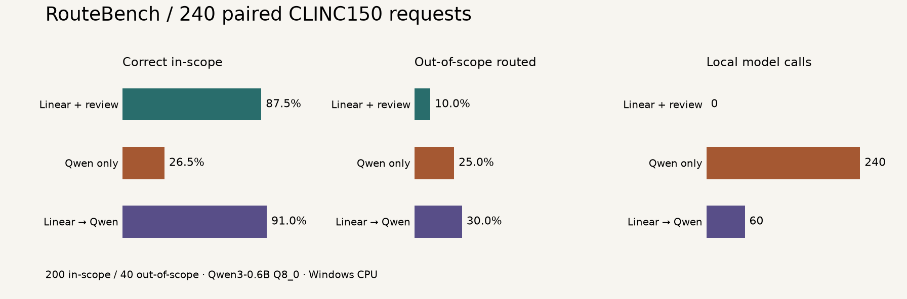

# RouteBench

RouteBench measures whether a short English request should go to a known workflow, a local language model, or human review. It compares a CPU classifier and a small quantized model on the same requests. It returns route labels; an application decides what those labels mean.

**Author** Peyman Gholamhosseini

## What the first run found

The default review gate reduced false acceptance from 1,000 to 123 of 1,000 out-of-scope requests on the full official test. On a paired 240-request sample, the Qwen fallback recovered seven correct routes and added eight out-of-scope false accepts. That raised the measured decision cost from 0.254 to 0.775 per request. The review gate is the default, with the local fallback available for comparison.



## Run it

Use Python 3.11 or newer. The published dataset is downloaded once and checked against pinned hashes. The commands run without a GPU or a hosted API.

```sh
python -m venv .venv
# Activate the environment for your shell.
python -m pip install -e '.[dev]'
routebench fetch
routebench classify "What is the balance on my checking account?"
routebench evaluate --output .runtime/linear.json
python -m pytest -q
```

`classify` fits the classifier and chooses the validation threshold on each invocation. The returned `elapsed_ms` measures classification after fitting. `label: null` is a review decision. `label: "out_of_scope"` is an explicit local-model classification. Both keep the request out of the ten supported routes.

## Add a local model

Download [Qwen3-0.6B Q8_0](https://huggingface.co/Qwen/Qwen3-0.6B-GGUF/blob/23749fefcc72300e3a2ad315e1317431b06b590a/Qwen3-0.6B-Q8_0.gguf) and [llama.cpp b11476](https://github.com/ggml-org/llama.cpp/releases/tag/b11476). The checkpoint is 639,446,688 bytes and its SHA-256 is `9465e63a22add5354d9bb4b99e90117043c7124007664907259bd16d043bb031`.

```sh
llama-server --model Qwen3-0.6B-Q8_0.gguf --host 127.0.0.1 --port 18982 --ctx-size 2048 --parallel 1 --threads 4 --threads-batch 4 --n-gpu-layers 0 --reasoning off --no-cache-prompt --alias routebench-qwen
```

From a second terminal:

```sh
routebench evaluate --local-url http://127.0.0.1:18982/v1/chat/completions --output .runtime/local.json
```

The local comparison makes 240 sequential requests by default and can take several minutes on a CPU. `--per-domain 2 --outside 4` runs a short smoke check. `classify` also accepts `--local-url`. Local output is constrained to a route code. Timeouts, invalid responses and unavailable servers leave the request for review.

## Evaluation protocol

1. Map CLINC150's 150 intents to the ten domains in the authors' mapping. Train word and character TF-IDF with logistic regression on the 15,000 published in-scope training requests.
2. Pick a threshold on the 3,000 in-scope and 100 out-of-scope validation requests by minimizing domain-balanced cost. Cost units are illustrative. A wrong label on an in-scope request costs 5, including an incorrect decision to mark it out of scope. Routing an out-of-scope request costs 8. Sending an in-scope request to review costs 1. Correct decisions and reviewing an out-of-scope request cost zero.
3. Score the linear classifier and review gate on all 5,500 official test requests. The paired local comparison uses 20 requests from each domain and 40 out-of-scope requests, selected by SHA-256 ordering of published split row IDs with salt `routebench-clinc-test-v1`. No example text is rewritten.
4. Run the local model on each paired case. Replay those same measured model responses for requests that the gate deferred. This yields a paired comparison of decisions and model call counts. Cascade latency sums measured component latencies. The reported prompt and output token counts come from the server and measure volume, with no conversion to currency or energy.

See [evaluation notes](reports/EVALUATION.md) and [per-case results](reports/clinc150-cpu.json). The JSON includes publisher row IDs, labels and decision traces. Utterance text and model weights are downloaded separately.

## Sources and scope

The [CLINC150 corpus](https://github.com/clinc/oos-eval/tree/828f8093932c8fe6ca7936c3d2e52903b1c523de) is crowdsourced, annotated English benchmark data under [CC BY 3.0](https://github.com/clinc/oos-eval/blob/828f8093932c8fe6ca7936c3d2e52903b1c523de/LICENSE). Cite [Larson et al., EMNLP 2019](https://aclanthology.org/D19-1131/). The paired subset has a fixed mix of 200 in-scope and 40 out-of-scope requests. The original splits contain two unique train–test text overlaps after case folding and trimming. Model pretraining overlap is unknown. Live support traffic, Persian text, intent-level routing and integration with real workflows need separate evaluation.

The comparison follows current work on [metrics beyond accuracy in agent evaluation](https://citp.princeton.edu/sites/g/files/toruqf6781/files/documents/emerging-trends-paper.pdf) and [running quantized models on local hardware](https://huggingface.co/blog/transformers-llama-cpp-quants). Project code is licensed under [MIT](LICENSE). The Qwen checkpoint has its own Apache 2.0 license.
